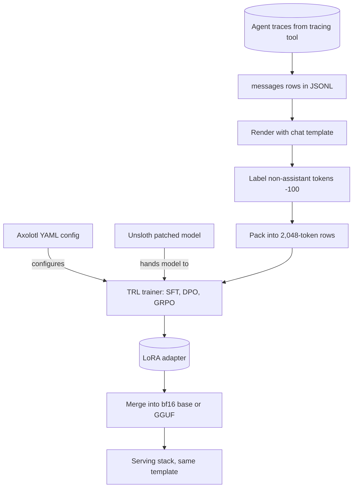

## TL;DR
When an agent needs a tuned model, the loop is fixed: load, maybe quantise, attach LoRA, render traces
with tool calls, train, save the adapter. TRL provides trainers, Axolotl reproducible YAML, Unsloth fast
single-GPU LoRA. These train models; LangChain and LangGraph run agents.

## For agent builders
- **Why it matters for agents.** You reach these tools when the fine-tune decision says "train": a small
  model that calls your tools reliably, a cheaper router step, or a model that answers from retrieved
  context. The tools encode the masking and template rules that decide whether that model behaves the
  same in your agent loop as in the notebook.
- **Where it shows up in your stack.** The training layer, offline, beside your agent, not in it.
  Orchestration (LangChain, LangGraph, the OpenAI Agents SDK, a plain loop) and tracing/evals (LangSmith,
  Langfuse) live in the agent frameworks module; serving is vLLM, Ollama or llama.cpp. Traces exported
  from your tracing tool become the training rows here.
- **What you control.** Which traces become data, the chat template and tool-call format (identical in
  training and serving), loss masking to assistant turns, LoRA rank, learning rate, epochs and the
  held-out agent eval.
- **What you can skip.** Writing a training loop, Triton kernels and GRPO internals, unless you are doing
  RL on agent rewards. Managed fine-tuning APIs hide this layer entirely.

## Why it exists
- **The hard part was never the loop.** Before these tools every fine-tune was a bespoke script, and the
  work was the dozen details around it:
  - render chat data through the exact template the model expects;
  - mask the loss so the model learns assistant turns, not the user's questions or tool results;
  - pack sequences without letting examples attend to each other;
  - inject LoRA into the right projection matrices;
  - mixed precision, gradient checkpointing, a 4-bit base with paged optimizers, checkpoint and resume,
    logging. Each is a few lines and easy to get subtly wrong.
- **Preference training adds a second layer.** DPO needs log-probabilities from a reference model on
  exactly the right tokens; GRPO needs a generation loop, reward functions and group-relative advantages.
- **The mistakes do not crash.** Loss on prompt tokens gives a model that parrots questions. A template
  mismatch between training and serving gives a model that looked fine in the notebook and misbehaves in
  vLLM, which for an agent means tool calls the parser cannot read. A padded-token bug in DPO gives a model
  slightly worse for reasons nobody can diagnose.
- **What the tools buy.** They encode the known-good recipe, so the only variables left are the ones that
  should vary: data, hyperparameters and evaluation. Teams that write the loop from scratch reproduce
  these bugs one at a time, over weeks.
- **Where a hand-written loop still fits.** It is the right way to *learn* what happens, and the escape
  hatch for a genuinely new loss, but not the way to ship a fine-tune.

## How it works
### Where this sits in an agent stack
| Layer | Examples | Job |
|---|---|---|
| Orchestration | LangChain, LangGraph, LlamaIndex, OpenAI Agents SDK, plain SDK loop | Runs the tool-calling loop, state, memory |
| Tracing and evals | LangSmith, Langfuse | Stores runs, golden sets, scores; source of training traces |
| Serving | vLLM, Ollama, llama.cpp, hosted APIs | Runs the model the agent calls |
| Training (this lesson) | TRL, Axolotl, Unsloth | Produces the adapter or merged model you then serve |

### At a glance
| Tool | Layer | You write | Best for |
|---|---|---|---|
| TRL | Trainers on top of `transformers` and PEFT | Python | Control, custom losses, newest methods |
| Axolotl | Config over Transformers/TRL/PEFT/`accelerate` | YAML | Reproducible runs, dataset formats, multi-GPU |
| Unsloth | Kernels under a TRL trainer | Two wrapper calls, then TRL | Fast, light LoRA/QLoRA on one GPU |

### TRL: trainers as the primitive
- **Where it sits.** TRL sits on top of `transformers` and PEFT. Unsloth hands its patched model to TRL
  trainers. Axolotl uses TRL for its preference and RL trainers; its SFT path subclasses the Transformers
  `Trainer` directly, with its own packing and loss masking.
- **`SFTTrainer` with `SFTConfig`.** Accepts a dataset of `messages` (conversational) or plain `text`,
  renders it with the tokenizer's chat template, optionally packs sequences, applies LoRA through a
  `peft_config`, and runs the standard `Trainer` loop. Agent traces are conversational rows whose
  assistant turns carry tool calls; check your TRL version's docs for how it passes tool schemas.
- **`DPOTrainer`.** Takes `prompt`/`chosen`/`rejected` rows, computes the log-probability ratio of each
  answer against a reference model, and minimises `−log σ(β · (Δ_chosen − Δ_rejected))`. With a LoRA
  policy the reference is the base model with the adapter disabled, so no second copy is held in memory.
- **`GRPOTrainer`.** Samples several completions per prompt (optionally through vLLM), scores them with
  plain Python reward functions, and normalises rewards within each group to form advantages. The reward
  can be an agent check, such as "the emitted tool call parses and names a valid tool".
- **`RewardTrainer` and `PPOTrainer`.** Cover the classic RLHF path.
- **Why choose it.** You write Python and every piece is overridable; that is the point. TRL is the layer
  for people who need control or a custom loss.

### Axolotl: the run as a config file
- **One YAML document describes the run:** base model, adapter type (full, LoRA, QLoRA), LoRA rank and
  targets, datasets with their format type (`alpaca`, `sharegpt`, `chat_template`, and others), sequence
  length, sample packing, micro-batch and accumulation, learning rate and scheduler, precision,
  FlashAttention, gradient checkpointing, DeepSpeed or FSDP settings, and experiment tracking.
- **What it does with it:** tokenises and packs the data once and caches it, launches through
  `accelerate` so a one-GPU test and an eight-GPU run use the same file, and can merge the adapter
  afterwards.
- **Why it exists:** the dataset format matrix is a genuine pain, and a config file in git is a
  reproducible experiment; a Python script with twenty keyword arguments is not.

```yaml
base_model: Qwen/Qwen2.5-7B-Instruct
adapter: qlora
load_in_4bit: true
lora_r: 16
lora_alpha: 32
lora_target_linear: true
datasets:
  - path: data/support_chats.jsonl
    type: chat_template
sequence_len: 4096
sample_packing: true
micro_batch_size: 2
gradient_accumulation_steps: 8
num_epochs: 2
learning_rate: 2e-4
lr_scheduler: cosine
bf16: auto
flash_attention: true
gradient_checkpointing: true
output_dir: ./out/support-qlora
```

Run it with the Axolotl CLI (`axolotl train config.yml`; older releases use
`accelerate launch -m axolotl.cli.train config.yml`).

### Unsloth: the kernels
- **What it replaces.** The attention, MLP and LoRA forward and backward passes of supported model
  families, with hand-written Triton kernels and manual autograd.
- **Why that is faster.** Fewer intermediate tensors are materialised, more operations are fused, and the
  cross-entropy over the vocabulary is computed in chunks instead of as one huge logits tensor, which
  matters for long agent traces.
- **Its own checkpointing variant.** It offloads block inputs to CPU asynchronously
  (`use_gradient_checkpointing="unsloth"`).
- **A two-call API.** `FastLanguageModel.from_pretrained(name, max_seq_length=..., load_in_4bit=True)` then
  `FastLanguageModel.get_peft_model(model, r=16, target_modules=[...], lora_alpha=16, ...)`; then hand the
  model to a TRL trainer as usual.
- **The claimed gain.** The project's own figures are roughly 2× faster training and substantially lower
  VRAM than stock Transformers plus PEFT on the same GPU. Treat those as vendor claims and benchmark on
  your model.
- **Sharp edges.** Only patched architectures are accelerated, and the open-source release has
  historically been single-GPU focused, so check the current docs before planning a multi-GPU run around
  it.
- **Exports.** Merged 16-bit weights, bare adapters, or GGUF for llama.cpp.

### How they compose
- **TRL is the base.**
- **Axolotl configures** Transformers/TRL/PEFT/`accelerate` from YAML.
- **Unsloth swaps in faster kernels** underneath a TRL trainer.
- **Same mental model elsewhere.** Similar config-driven frameworks exist (LLaMA-Factory, torchtune).

## Diagram
Agent traces flow through the same steps whichever tool drives training; the adapter then goes back to
the serving stack your agent calls, with the same template.



## Examples
### Agent traces to training rows, with a tool-call render check
Turn successful agent runs into conversational rows that keep the tool calls, then render one through
the chat template with its tool schemas. If the rendered text does not show the tool call in the
model's native format, the tuned model will not learn to emit it.

```python
import json
from transformers import AutoTokenizer

tok = AutoTokenizer.from_pretrained("Qwen/Qwen2.5-7B-Instruct")
TOOLS = [{"type": "function", "function": {
    "name": "lookup_order", "description": "Fetch an order by id",
    "parameters": {"type": "object", "properties": {"order_id": {"type": "string"}},
                   "required": ["order_id"]}}}]

row = {"tools": TOOLS, "messages": [
    {"role": "system", "content": "You are a support agent. Use tools before answering."},
    {"role": "user", "content": "Where is order 8812?"},
    {"role": "assistant", "content": "", "tool_calls": [{"type": "function", "function": {
        "name": "lookup_order", "arguments": {"order_id": "8812"}}}]},
    {"role": "tool", "name": "lookup_order", "content": '{"status": "shipped"}'},
    {"role": "assistant", "content": "Order 8812 has shipped."},
]}

text = tok.apply_chat_template(row["messages"], tools=row["tools"], tokenize=False)
print(text)                                    # inspect: tool schema, tool call, tool result, answer
assert "lookup_order" in text and "8812" in text

with open("agent_sft.jsonl", "w") as f:        # keep only runs that passed your agent eval
    f.write(json.dumps(row) + "\n")
# Loss should cover the assistant tool call and the final answer; the system, user and tool-result
# turns are context. Confirm that with the pre-flight label check below.
```

### LoRA SFT with TRL
A LoRA SFT on reviewed support conversations. The rows carry a `messages` list, so the trainer renders
them with the model's chat template. The adapter is saved on its own and merged into the bf16 base later
only if the serving stack needs a single checkpoint. The commented lines show the Unsloth swap-in.

```python
from datasets import load_dataset
from peft import LoraConfig
from transformers import AutoModelForCausalLM, AutoTokenizer
from trl import SFTConfig, SFTTrainer

name = "Qwen/Qwen2.5-1.5B-Instruct"
tok = AutoTokenizer.from_pretrained(name)
model = AutoModelForCausalLM.from_pretrained(name, torch_dtype="bfloat16")

# rows: {"messages": [{"role": "user", "content": ...}, {"role": "assistant", "content": ...}]}
ds = load_dataset("json", data_files="support_chats.jsonl", split="train")

peft_cfg = LoraConfig(r=16, lora_alpha=32, lora_dropout=0.05, task_type="CAUSAL_LM",
                      target_modules=["q_proj", "k_proj", "v_proj", "o_proj",
                                      "gate_proj", "up_proj", "down_proj"])

args = SFTConfig(
    output_dir="out/support-lora",
    per_device_train_batch_size=4, gradient_accumulation_steps=4,   # effective batch 16
    learning_rate=2e-4, num_train_epochs=2, lr_scheduler_type="cosine", warmup_ratio=0.03,
    bf16=True, gradient_checkpointing=True, packing=True,
    max_length=2048,                     # older TRL releases call this max_seq_length
    assistant_only_loss=True,            # needs a chat template that marks assistant turns;
    logging_steps=10, save_strategy="epoch",   # otherwise use prompt/completion rows
)
trainer = SFTTrainer(model=model, args=args, train_dataset=ds,
                     processing_class=tok,   # tokenizer= in older TRL releases
                     peft_config=peft_cfg)
trainer.train()
trainer.save_model()                     # writes the adapter only

# Unsloth variant: from unsloth import FastLanguageModel
# model, tok = FastLanguageModel.from_pretrained(name, max_seq_length=2048, load_in_4bit=True)
# model = FastLanguageModel.get_peft_model(model, r=16, lora_alpha=32, target_modules=[...])
# then build SFTTrainer(model=model, ...) with peft_config=None.
```

What the trainer does with one row is the part worth verifying by hand:
1. **Render.** The `messages` list goes through Qwen's ChatML template, in which each turn becomes
   `<|im_start|>{role}\n{content}<|im_end|>`, then is tokenised.
2. **Mask.** With `assistant_only_loss`, every system and user token gets label −100, so only the
   assistant span contributes to the loss.
3. **Pack.** Rendered rows are concatenated into 2,048-token sequences. With a padding-free /
   position-id-aware attention path each row restarts its positions, so it cannot attend to its neighbour.

### Counting steps before you launch
Illustrative numbers for the run above, and for an agent-trace run with longer rows:

| Quantity | Support chats | Agent traces |
|---|---|---|
| Data | 3,000 chats averaging 500 tokens = 1.5M tokens | 2,000 traces averaging 6,000 tokens = 12M tokens |
| Packed length | 2,048 | 8,192 |
| Tokens per optimizer step (effective batch 16) | 16 × 2,048 ≈ 32.8k | 16 × 8,192 ≈ 131k |
| Steps per epoch | ~46 | ~92 |
| Steps for two epochs | ~92 | ~184 |
| `warmup_ratio=0.03` | about three steps | about six steps |
| `save_strategy="epoch"` | two checkpoints | two checkpoints |

- **Agent traces carry less loss per token.** Tool schemas and tool results are context, so only the
  assistant tool calls and answers are trained; expect a much smaller trained share than in chat data.

### Pre-flight: print what the loss actually sees
Decode one packed batch and print its labels before the first real run. It takes a minute and catches
template and masking bugs that the loss curve never shows. Run it on the `trainer` built above, before
`trainer.train()`.

```python
batch = next(iter(trainer.get_train_dataloader()))
ids, labels = batch["input_ids"][0], batch["labels"][0]
trained = labels != -100

print(f"{trained.float().mean():.0%} of tokens carry loss")   # far below 100% for chat data
print("TRAINED ON:\n", tok.decode(ids[trained])[:600])        # should read as assistant answers only
print("IGNORED:\n", tok.decode(ids[~trained])[:600])          # system and user turns, template tokens
# If TRAINED ON contains user questions, masking is off: check the chat template or use
# prompt/completion rows. If it contains two unrelated chats glued together, check packing.
```

## Production patterns
- **Traces to data, gated by evals.** Agent teams export runs from their tracing tool, keep only those
  that passed the agent eval or a human review, store the tool schemas with each row, and de-duplicate
  near-identical runs. Hash the resulting JSONL per training run, and monitor the pass rate of exported
  traces so a regression does not quietly enter the data.
- **Pin the training stack per run.** TRL and Transformers rename arguments across releases, so lock exact
  versions of `trl`, `transformers`, `peft` and `accelerate` in a lockfile or container image tagged with
  the run. Monitor deprecation warnings in the training log as an early signal before upgrading.
- **One committed config per experiment.** Keep the Axolotl YAML in git next to a hash of the dataset
  file, and run `axolotl preprocess config.yml` once so tokenisation and packing are cached and
  inspectable. Track run name, commit and data hash in the experiment tracker.
- **Template and tool-call parity test in CI.** Render the same conversation, with tools, using
  `tok.apply_chat_template(...)` in the training image and the serving image and assert identical token
  ids. In vLLM, pick the `--tool-call-parser` that matches the template's tool-call format. Monitor
  production for stray special tokens such as a literal `<|im_end|>` and for unparseable tool calls.
- **Pre-flight label check and Unsloth benchmark.** Run the batch-decoding snippet on every new dataset
  and record the share of tokens carrying loss; a sudden jump toward 100% means masking broke. Before
  standardising on Unsloth, run about 50 steps with stock PEFT and with Unsloth and compare tokens per
  second and `torch.cuda.max_memory_allocated()`.
- **Evaluate the artifact you ship, inside the agent.** If serving needs one checkpoint, merge into the
  bf16 base (PEFT's `merge_and_unload()`), then re-run the held-out agent eval (task success, tool-call
  validity) on the merged model behind the real serving stack, not just the adapter in a notebook.

## Trade-offs
- **TRL: control vs plumbing.** Full control and the newest algorithms first, but you own the plumbing
  around the trainer (data formatting, launch, multi-GPU config). It flips toward Axolotl once a team runs
  many similar jobs.
- **Axolotl: reproducibility vs flexibility.** Reproducible configs and painless multi-GPU, but a custom
  loss or unusual data flow means reading its source. It flips back to raw TRL when the experiment is not
  one of its supported shapes, such as RL with a custom agent reward.
- **Unsloth: speed vs coverage.** Real speed and memory savings on one GPU, but only for patched
  architectures and with single-GPU focus historically. It flips to Axolotl or plain FSDP when the job
  needs several GPUs.
- **Self-training vs a managed fine-tuning API.** These tools give full control over data, template and
  serving, at the cost of owning GPUs and the parity tests. A provider's fine-tuning API removes that
  work but ties the tuned model to that provider; it flips toward self-training when you must self-host.
- **Convenience vs verification.** Every layer of convenience hides a decision: the lower you go, the more
  you must verify yourself; the higher you go, the more you must trust defaults you did not read.

## Pitfalls
- **Chat-template mismatch between training and serving.** Symptom: a model that behaves in the training
  notebook but misbehaves or emits stray special tokens once deployed in vLLM or Ollama; in an agent, tool
  calls arrive as plain text the loop cannot parse. Fix: one template source and a parity test.
- **Computing the loss over prompt tokens.** Symptom: suspiciously low training loss alongside a model
  that generates user-style questions or echoes instructions. Fix: assistant-only or completion-only loss,
  verified by decoding labels.
- **Training on failed or unreviewed agent runs.** Symptom: the tuned agent faithfully reproduces loops,
  wrong tools and hallucinated arguments from production. Fix: filter exported traces by eval pass or
  review before they become rows.
- **Packing without per-example attention masking.** Symptom: answers that drift into the topic of a
  neighbouring training example, which is context bleed across the pack. Fix: a padding-free,
  position-id-aware attention path.
- **Pinning nothing.** TRL and Transformers rename arguments across releases (`tokenizer` →
  `processing_class`, `max_seq_length` → `max_length`). Symptom: a job that ran last month fails on an
  unknown keyword. Fix: pin versions.
- **Merging a QLoRA adapter into the 4-bit base instead of the bf16 base.** Symptom: a merged model that
  scores worse than the adapter-plus-base it came from. Even a bf16 merge is slightly off, because the
  adapter was trained against dequantised 4-bit weights, so re-run the eval on the merged artifact.
- **Trusting Unsloth's speedup without checking the architecture list.** Symptom: an error at load or a
  run that is no faster than stock Transformers. Fix: check the supported list and benchmark.

## When to use
- **Reach for TRL when:** you need a trainer class in your own Python, a custom reward or loss (for
  example a tool-call validity reward), or the newest method the day it lands.
- **Reach for Axolotl when:** runs must be reproducible across people and machines, you juggle several
  dataset formats, or the job spans several GPUs.
- **Reach for Unsloth when:** the job is a LoRA or QLoRA on one GPU and the model family is supported,
  because the saving in time and VRAM is large enough to change what fits.
- **Skip all three when:** the fine-tune decision has not said "train" yet, or a managed fine-tuning API
  on your hosted model covers the job.
- **Measure, whatever you pick:** tokens per second, peak memory, eval score on a held-out set, and an
  end-to-end check through the serving stack's chat template.
- **Interviews:** place the three on a control-versus-convenience axis and name the failure modes the
  tools exist to prevent.

## Role lens
- **Engineer:** Writes the TRL or Axolotl config, verifies loss masking and the chat template on one
  example by hand, and benchmarks Unsloth against stock PEFT before committing to it.
- **Architect:** Chooses the standard stack for the organisation so runs are reproducible and auditable,
  and decides where custom TRL code is allowed versus config-only training.
- **FDE:** Gets a customer's first LoRA running on the GPU they already have, often Unsloth on one card,
  and leaves behind an Axolotl config the customer's team can re-run without you.

## Check yourself
**Q:** You have 3,000 reviewed support chats and a single 24 GB GPU. A colleague proposes writing a
custom PyTorch training loop. Which tool would you pick, why, and what decisions would still be yours?
**A:** A QLoRA SFT through TRL's `SFTTrainer`, loaded with Unsloth if the model family is supported,
because that fits a 7B-class model on 24 GB and removes the known bugs a hand-written loop reinvents:
template rendering, loss masking, packing, adapter injection and checkpointing. Axolotl would be the
pick if the run must be reproducible for others or move to several GPUs later. What remains yours: data
quality and de-duplication, the chat template matching the serving stack, confirming the loss covers only
assistant turns, LoRA rank, learning rate and epochs, a held-out eval set, and whether to serve the
adapter or merge it into the bf16 base.

## Interview questions
### What do TRL, Axolotl and Unsloth actually save you compared with a hand-written loop?
- **Not the loop itself,** which is short. They save the details around it: chat-template rendering, loss
  masking, packing, LoRA injection, precision, checkpointing and resume.
- **Why that matters:** those bugs do not crash. They produce a model that parrots questions or misbehaves
  only after deployment, and a team finds them one at a time over weeks.
- **What stays yours:** data quality, hyperparameters and evaluation.

### Your fine-tuned model is fine in the notebook, but in the agent its tool calls arrive as plain text with stray end tokens. How do you debug it?
- **Suspect a template mismatch first.** Render one conversation, with tools, using the training
  tokenizer's chat template and the serving stack's, and diff the token ids.
- **Check stop tokens and the tool parser:** the serving config must treat the template's end-of-turn
  token (for ChatML, `<|im_end|>`) as a stop sequence, and the tool-call parser must match the format the
  template emits.
- **Fix at the source:** ship the tokenizer and template with the adapter, and add a parity test so it
  cannot drift again.

### You want a small model that handles your agent's tool calls. How do you turn production traces into training data?
- **Export and filter:** take runs from the tracing tool that passed the agent eval or human review, so
  the model does not learn production loops and wrong tools.
- **Keep the structure:** store each run as `messages` with assistant tool calls and tool results, plus
  the tool schemas, and render with the target model's chat template.
- **Verify the loss:** decode one batch; only assistant tool calls and answers should carry loss. Then
  score task success on a held-out set through the real serving stack.

### When would you not use Unsloth or Axolotl?
- **Not Unsloth** when the model architecture is not patched, or the job needs several GPUs, because the
  speedup disappears and the open-source release has historically been single-GPU focused.
- **Not Axolotl** when the experiment needs a custom loss or unusual data flow, because you end up reading
  and patching its source; drop to TRL and write Python.
- **Not either** when the goal is learning the mechanics; write the loop once by hand.

### 10,000 chats averaging 800 tokens, 4,096-token packing, effective batch 16. How many steps per epoch?
- **Tokens:** 10,000 × 800 = 8M tokens.
- **Per optimizer step:** 16 × 4,096 = 65,536 tokens, so about 122 steps per epoch.
- **Why compute it:** it sets warmup (a ratio of 0.03 of a one-epoch run is about four steps), how many checkpoints a
  per-epoch save writes, and whether logging every 10 steps gives a readable loss curve.

### How does DPO with a LoRA policy avoid holding two copies of the model?
- **DPO needs a reference model** to compute each answer's log-probability ratio.
- **With LoRA, the reference is the base with the adapter disabled,** so TRL computes reference
  log-probabilities from the same weights, and no second copy is held in memory.
- **The trade-off:** extra forward passes per batch instead of extra memory.

## Quiz
### Q: How do TRL, Axolotl and Unsloth relate to each other?
- [ ] They are three competing training loops that cannot be combined
- [x] TRL provides the trainers; Axolotl configures them from YAML; Unsloth accelerates the kernels beneath them
- [ ] Axolotl is the base library and TRL is its command-line wrapper
- [ ] Unsloth replaces TRL entirely with its own trainer classes
> TRL is the primitive layer. Axolotl orchestrates Transformers, TRL, PEFT and accelerate from a config file,
> and Unsloth patches the model's forward and backward passes, then hands the model to a TRL trainer.

### Q: What is the actual mechanism behind Unsloth's speed and memory savings?
- [ ] It silently trains a smaller distilled model in place of the one you loaded
- [ ] It skips the backward pass through all frozen base-model layers
- [x] Hand-written fused Triton kernels and manual backward passes that cut intermediate tensors and memory traffic
- [ ] It performs all arithmetic in 4-bit integers instead of bf16
> The base weights may be stored in 4-bit, but compute still happens in 16-bit; the gain comes from fused
> kernels, chunked loss computation and fewer materialised intermediates, not from changing the model.

### Q: Which symptom most strongly suggests the loss was not masked to assistant tokens?
- [ ] Out-of-memory errors in the first training step
- [ ] A NaN loss after the warmup phase
- [x] Training loss that looks unusually low while the model generates user-style questions
- [ ] Loss that never decreases from its initial value
> Averaging the loss over the easy-to-predict user turns pulls the number down, and the model learns to
> continue conversations in the user's voice because that is what it was trained to predict.

## Use cases & projects
### Use cases
- **A small model for one agent step.** TRL or Unsloth LoRA on exported traces gives a cheap model for a
  router, classifier or extraction step that a large model handled well but expensively.
- **Reliable tool calling in an open-weights agent.** Training on rendered tool-call traces with the same
  chat template you serve with fixes calls that arrive as plain text or malformed JSON.
- **Reproducible fine-tunes across a team.** An Axolotl YAML checked in beside the agent code makes the
  run reviewable and repeatable when the base model or the trace set changes.
- **Preference tuning from agent feedback.** Thumbs-up and thumbs-down pairs from production become DPO
  data in TRL, nudging tone or tool choice without a full RL setup.

### Mini project
**LoRA a small model on your agent's tool-call traces (2-3 hours).**
- **Goal:** fine-tune a small instruct model so it emits your agent's tool calls in a format your serving
  stack parses, and prove it with a held-out agent eval.
- **Steps:** export 200-500 successful traces with their tool schemas; convert them to chat rows and run
  the tool-call render check from Examples; print which tokens the loss sees; train a LoRA with TRL
  `SFTTrainer` (or Unsloth on one GPU); serve base and tuned models behind the same agent loop and run 50
  held-out tasks.
- **Done when:** you have parse-success and task-success rates for base versus tuned model, the loss mask
  shows only assistant turns, and the adapter loads and calls tools correctly in the serving engine.
