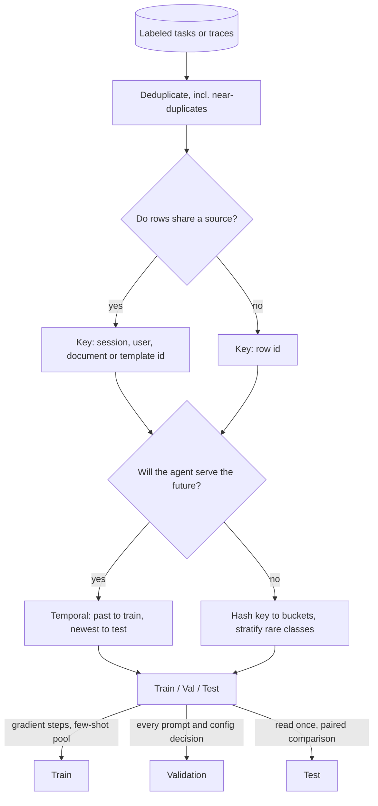

## TL;DR
Agent teams iterate prompts, tools and models against a dev set, so its score is biased; a test set read
once gives the honest number. Cut on the unit the agent must generalise across (session, user, document,
task template, time), not rows.

## For agent builders
- **Why it matters for agents.** Every prompt tweak you keep because the dev score rose is a decision
  fit to that set. After fifty iterations the dev score overstates production, exactly as tuning twenty
  learning rates does. The same rule governs any fine-tune on agent traces.
- **Where it shows up in your stack.** Eval datasets in LangSmith, Langfuse or your own JSONL, the
  `validation_file` or eval split you hand a fine-tuning job, and the regression suite in CI that gates
  a prompt or model change.
- **What you control.** The split key (session, customer, source document, task template), the size of
  each held-out set, how often the test set is read, and whether two agent configs are compared paired on
  the same tasks.
- **What you can skip.** Cross-validation theory. LLM runs are too expensive for many folds; spend the
  effort on the split key, the sizes and paired comparisons.

## Why it exists
- **Training loss and dev scores say nothing about new data.** Training minimises loss on the examples
  it sees; a model that memorised every row would score perfectly. Held-out data is the only instrument
  that measures generalisation, for a fine-tuned model and for a prompt tuned by hand.
- **One held-out set stops being enough once you decide with it.** Try twenty learning-rate and epoch
  combinations, or twenty system-prompt variants, and keep the best validation score. Each score is true
  quality plus noise, so the maximum of twenty picks the luckiest noise too, and the winner overstates
  production.
- **Selection bias needs a second, untouched set.** Statisticians call it selection bias; practitioners
  call it overfitting the validation set. The fix is the same: a held-out set no decision ever touched,
  read once.
- **"Shuffle the rows and cut 80/20" fails quietly.** Rows are rarely independent: four turns of one
  support conversation, ten chunks of one PDF, fifty events from one user, twenty agent tasks generated
  from one template, last month's and this month's tickets. Train on some, test on the rest, and the
  model is rewarded for recognising the source.
- **The split level is the claim.** A split is only meaningful when made at the level on which you
  expect the model to generalise; otherwise the number has no relationship to a genuinely new case.

## How it works
### Three roles, not three ratios
| Set | Role | Read how often |
|---|---|---|
| **Train** | receives gradient steps; nothing else is fit to it (for a prompt-only agent, the few-shot examples and the cases you debug against) | every step |
| **Validation** (dev) | every choice made by looking at a number: hyperparameters, early stopping, checkpoint selection, decision thresholds, prompt and template variants, tool descriptions | as often as you like, which is exactly why its final score is biased upward |
| **Test** | the one-shot estimate | once; read, change, read again and it is a second validation set |

- **When the test set is consumed,** disciplined teams carve a fresh one out of newly arrived data, such
  as last month's production traces, labeled.

### How big each set should be
Ratios such as 80/10/10 are inherited from the small-data era. What matters is the absolute size of the
held-out sets, because the standard error of a measured accuracy (or agent success rate) *p* on *n*
examples is about `sqrt(p·(1−p)/n)`.

| n (at p = 0.9) | Standard error |
|---|---|
| 100 | ±3 points |
| 200 (a 10% slice of 2,000 fine-tuning examples) | about ±2 points |
| 1,000 | ±0.95 points |
| 10,000 | ±0.3 points |

- **Small test sets cannot separate close models.** A 1,000-example test set cannot separate two models
  one point apart, however large the training set is. The 200-row slice cannot reliably separate two
  models two points apart.
- **Agent eval sets are usually small.** A few hundred hand-labeled tasks is common because each one
  needs a sandbox, fixtures and a grader, so error bars of several points are normal and must be shown.
- **Huge datasets need tiny fractions.** With ten million rows a 1% test set is 100,000 rows, far more
  than needed.
- **Rule:** choose held-out sizes from the effect you need to detect, then give everything else to
  training.

### Comparing two models or two agent configs
- **Unpaired is noisier.** If each model were scored on an independent sample, the noise on the
  *difference* would be about √2 times the single-model error.
- **Paired is tighter.** Score both on the same items: most items are answered identically, and only the
  items where they disagree carry information about which is better.
- **Use a paired test** on those discordant items (McNemar's test, or a paired bootstrap over items)
  rather than eyeballing two error bars. This is one more reason to keep the test set fixed and shared
  across every candidate.
- **Agents add run-to-run noise.** The same agent can pass a task on one run and fail it on the next, so
  run each task several times per config and compare per-task pass rates, still paired by task.

### Ways to cut
1. **Random.** Only valid when rows are independent and identically distributed, which is rarer than it
   looks.
2. **Stratified.** Preserve class or category proportions in every split. Essential when a class is rare:
   a random 10% slice of 50 positives can easily contain two of them, and the metric on that class
   becomes a coin flip. For agents, stratify by task type and by which tools a task needs.
3. **Grouped.** Assign whole groups (conversation, user, document, source repository, task template) to a
   single split. Hashing the group id into a bucket makes the assignment deterministic and stable as new
   data arrives.
4. **Temporal.** Train on the past, validate on the recent past, test on the newest period. Mandatory
   when the data changes over time and the deployed model will serve the future, which covers most
   production systems; it also exposes drift early.
5. **Cross-validation.** *k* folds rotate the validation role, giving *k* estimates at *k* times the
   training cost. Worth it when data is small and training is cheap (classical models, small heads),
   rarely for LLM fine-tunes.

### LLM- and agent-specific rules
- **Deduplicate before splitting,** including near-duplicates such as one template with different
  fill-ins; otherwise validation is partly a copy of training and overfitting becomes invisible.
- **Check held-out sets for contamination** against any public benchmark you report and against data
  your base-model vendor may have pretrained on; a contaminated test set measures memory, not skill.
- **Split before fitting anything on data:** tokenizer training, normalisation statistics, target
  encodings, embedding-based filters. Fitting on the union leaks the held-out distribution into the
  pipeline.
- **Keep few-shot examples out of the eval set.** An example in the system prompt that also appears in the
  dev set makes that item free.
- **Keep two instruments.** Validation loss on the dev set is token-level, cheap and continuous; the task
  metric on the test set (for agents, end-to-end task success) is what the customer sees. Keep both.

## Diagram
Read it top to bottom: clean and choose the cut before anything is fit, then note that only the test set
is read exactly once.



## Examples
### Deterministic grouped split for agent traces
A split for a dataset of multi-turn agent sessions used both for fine-tuning and evaluation. Hashing the
session id means every turn and tool call of a session lands in the same split, the assignment never
changes when rows are added, and the result is identical on every machine.

```python
import hashlib
from collections import Counter

def bucket(key: str, buckets: int = 100) -> int:
    # Stable across processes and machines; Python's built-in hash() is salted per run.
    return int(hashlib.sha256(key.encode()).hexdigest(), 16) % buckets

def assign(example: dict) -> str:
    # Split on the unit of generalisation: all turns of one session travel together.
    b = bucket(example["session_id"])
    return "test" if b < 10 else "val" if b < 20 else "train"   # 10 / 10 / 80

rows = [{"session_id": f"sess-{i // 4}", "turn": i % 4,
         "label": "billing" if i % 7 == 0 else "other"} for i in range(4000)]
splits = {s: [r for r in rows if assign(r) == s] for s in ("train", "val", "test")}

for name, rs in splits.items():
    sessions = {r["session_id"] for r in rs}
    print(name, len(rs), "rows", len(sessions), "sessions", Counter(r["label"] for r in rs))

# Leakage check: no session may appear in two splits.
ids = {s: {r["session_id"] for r in rs} for s, rs in splits.items()}
assert not (ids["train"] & ids["val"]) and not (ids["train"] & ids["test"]) and not (ids["val"] & ids["test"])

# A row that arrives next month keeps the split its session already has.
assert assign({"session_id": "sess-17"}) == assign({"session_id": "sess-17"})
```

- **The `Counter` line is the stratification check.** If the `billing` share differs noticeably between
  splits, either enlarge the held-out sets or stratify within hash buckets.
- **Swap the key for the claim you make.** Hash `customer_id` if the agent must work for new customers,
  or a task-template id if eval tasks were generated from templates.
- **No groups?** scikit-learn's `train_test_split(..., stratify=y)` does the stratified cut directly.

### Worked comparison: is the new system prompt better?
Agent config B (new system prompt) is compared with config A on the same 300 held-out tasks: A succeeds on
210 (70%), B on 225 (75%). The paired view counts only the tasks where they differ.

| Outcome per task | Count |
|---|---|
| both succeed | 195 |
| only A succeeds | 15 |
| only B succeeds | 30 |
| both fail | 60 |

```python
from math import comb, sqrt

def mcnemar_exact(b, c):
    # b: tasks only config A solved, c: tasks only config B solved
    n, k = b + c, min(b, c)
    tail = sum(comb(n, i) for i in range(k + 1)) / 2 ** n
    return min(1.0, 2 * tail)                       # two-sided exact binomial test

print(f"single-config SE ~ {sqrt(0.7 * 0.3 / 300):.4f}")       # 0.0265: about ±2.6 points
print(f"McNemar exact p = {mcnemar_exact(15, 30):.3f}")          # 0.036
print(f"McNemar exact p = {mcnemar_exact(40, 25):.3f}")          # 0.082 for 40 vs 25
```

- **Reading it.** Each config's own error bar is about ±2.6 points, so the 5-point gap looks marginal,
  but pairing uses only the 45 discordant tasks, and 15 vs 30 gives p ≈ 0.04.
- **Caveat.** That holds only if this was the one planned comparison on a set nobody tuned against, and
  each task ran once; with stochastic runs, repeat each task and compare per-task pass rates.
- **Contrast.** Two models at 91.0% and 89.5% on 1,000 items (870 both right, 40 only A, 25 only B,
  65 both wrong; single-model SE 0.0095) give p ≈ 0.08 for the 1.5-point win from the 65 discordant
  items: suggestive, not
  conclusive at the usual 0.05 bar.
- **Decision rule.** When the paired test is inconclusive, do not ship on it alone; grow the test set
  with fresh items, keeping it paired, rather than re-reading the same set until something looks
  significant.

## Production patterns
- **Hash-keyed split in the data pipeline.** Assign split by hashing the group key (session, customer,
  document, task template) as in the first example, and store the split name on each row. Run the leakage
  assertion in CI on every dataset build; monitor per-split row and group counts for unexpected jumps.
- **Dev set for iteration, frozen test set for releases.** Run prompt, tool-description and model
  experiments against the dev dataset in your eval tool, and run the frozen test set only to sign off a
  release. Monitor how many times the test set has been read; retire it after the project's final
  comparison.
- **Library splitters for grouped and temporal cuts.** In scikit-learn, `GroupShuffleSplit` or
  `GroupKFold` keep groups together, `StratifiedGroupKFold` also balances classes, and `TimeSeriesSplit`
  gives forward-in-time folds. Monitor the class mix per fold with the `Counter` check.
- **Versioned, frozen evaluation sets.** Store validation and test sets as immutable, versioned files
  (content hash in the name) and record which version every reported score used, including the agent
  config and model version it was run with.
- **Rolling temporal test set.** For drifting traffic, rebuild the test set from the newest labeled
  production traces each cycle (for example the latest month) and keep the previous one as a regression
  set. Monitor the gap between the old and new test scores as a drift signal.
- **Paired evaluation by default.** Score every candidate on the same frozen tasks, several runs each for
  agents, and report a paired bootstrap interval or McNemar p-value next to the headline difference.
  Monitor discordant-task counts, because they set how small a difference you can detect.

## Trade-offs
- **Bigger held-out sets vs training data.** Larger validation and test sets give tighter estimates but
  take rows from training; the balance flips toward training when the dataset is a small fine-tuning set
  and a ±2-point error bar is acceptable.
- **Honest vs flattering numbers.** Grouped and temporal splits report lower numbers than a random split,
  and the lower number is the honest one; the random number was high precisely because it leaked.
- **Repeated agent runs vs eval cost.** Running each task several times per config separates real gains
  from sampling luck, but multiplies tool calls and tokens; it pays when the differences you care about
  are a few points.
- **Cross-validation vs cost.** It multiplies training cost by *k*; it pays only when the variance of a
  single split is large relative to the differences you need to detect.
- **Hash stability vs re-stratification.** A hash-based split is reproducible and stable as data grows,
  but cannot be re-stratified after the fact; rare classes must be checked or stratified within buckets.
- **One-shot test vs learning.** Reading the test set once gives an unbiased estimate but teaches you
  nothing for the next iteration; rotating in fresh test sets costs labelling effort but keeps honesty
  over a long project.

## Pitfalls
- **Splitting by row when rows share a source.** Symptom: validation accuracy far above production and a
  sharp drop the first time a new customer, document or user arrives. Fix: grouped split.
- **Iterating prompts on the test set.** Symptom: the eval score climbs every week while production
  success and user feedback stay flat, because the test set has quietly become a validation set. Fix:
  iterate on dev, sign off on a frozen test set read once, and carve a fresh one from newly arrived
  traces once it has been reused.
- **Fitting preprocessing before splitting** (scalers, tokenizers, vocabularies, filters). Symptom: a
  small, persistent optimistic bias that vanishes when the pipeline is rebuilt on train only. Fix: split
  first, fit every preprocessing step on train only.
- **Random splits with a rare class.** Symptom: the minority-class metric jumping between 0% and 100%
  across seeds. Fix: stratify.
- **Re-splitting with a new seed on every run.** Symptom: incomparable experiments and "improvements"
  that are nothing but split noise. Fix: a fixed, hashed split.
- **Temporal splits with whole-window features** (aggregates, embeddings fit on all periods). Symptom: a
  time-split test score that is still too good to be true. Fix: compute features only from data before
  each split's cutoff.
- **Validation drawn from the same synthetic template as training.** Symptom: near-perfect validation
  alongside poor human evaluation on real prompts. Fix: deduplicate templates across splits and hold out
  real prompts.

## When to use
Every supervised project and every agent eval needs the three roles; the decision is how to cut.
- **Grouped split:** the moment any two rows share an origin: a session, a customer, a document, a
  task template.
- **Temporal split:** whenever data arrives over time and the agent will serve the future.
- **Sizing:** size held-out sets from the standard-error formula against the smallest difference you
  need to detect.
- **Cross-validation:** for small classical models, not for LLM fine-tunes where one run is expensive.
- **Audit first when a model looks too good:** who made the split, on what key, and was anything fit
  before it.
- **Interviews:** "how would you split this data" really asks "what is the unit of generalisation and how
  would you stop leakage"; a strong answer names the key, the sizes and the one-shot test discipline.

## Role lens
- **Engineer:** Writes the deterministic split function, the leakage assertion and the stratification
  check into the data pipeline so every run uses the same held-out sets.
- **Architect:** Owns the policy that evaluation sets are versioned, group- or time-keyed, sized to the
  decision they support and refreshed when the test set has been consumed by iteration.
- **FDE:** Builds the held-out set with the customer's SMEs from their most recent data and defends a lower,
  honest number against the inflated one produced by a row-level random split.

## Check yourself
**Q:** You fine-tune a ticket classifier on 40,000 tickets from 3,000 customers with a random 80/10/10
split and get 94% validation accuracy, but the first new customer onboarded sees 78%. What happened, how
would you re-split, and how large should the held-out sets be?
**A:** The random split put tickets from the same customer on both sides, so the model learned
customer-specific signals (product names, signatures, phrasing) and the 94% measured recognition, not
classification. Re-split by hashing the customer id so each customer is entirely in one set, and
consider a temporal cut as well if ticket mix drifts. The honest number will fall toward 78%, which is
the number that matters. Sizing: 4,000 held-out tickets would give a standard error of about 0.5 points
at 90% accuracy if tickets were independent, but tickets from one customer are correlated, so the
effective sample lies somewhere between the ~300 held-out customers and the 4,000 tickets; expect wider
error bars (a customer-level bootstrap measures them) and stratify by category so rare ticket types
appear in every split. Finally, keep the test set untouched until the final comparison, and make that
comparison paired on the same customers so the error bar on the difference is as tight as the data allows.

## Interview questions
### Why do you need both a validation set and a test set?
- **Validation absorbs decisions.** Hyperparameters, early stopping, checkpoint and threshold choices are
  all made by looking at it, so the winning score includes the luckiest noise and is biased upward.
- **Test is the unbiased estimate** only if no decision ever touched it, which means reading it once.
  Read, change and read again, and it has become a second validation set.

### Your team has tuned the agent's system prompt against a 150-task eval set for two months. How much do you trust its score?
- **Not much as a production estimate.** Every kept change was selected on that set, so its score
  includes the luckiest noise of dozens of variants; it is now a dev set.
- **Build a fresh test set** from recent, labeled production traces, grouped by customer or session, and
  read it once for the release decision.
- **Expect a lower number** and report its error bar: at 150 tasks and 70% success,
  `sqrt(p·(1−p)/n)` is about ±3.7 points.

### How would you split a dataset of RAG question-answer pairs generated from 500 internal documents?
- **Unit of generalisation is the document.** Many questions come from the same chunk or PDF, so a row
  split rewards recognising the source text.
- **Cut:** deduplicate near-duplicate questions, then hash the document id into train, validation and
  test buckets so every question from one document lands in the same split.
- **Check:** assert no document id appears in two splits, and keep the class or topic mix comparable with
  a `Counter` per split; add a temporal cut if new documents keep arriving.

### Agent config B beats config A by 5 points on 300 tasks. Do you ship it?
- **Look at the paired view first:** only the tasks where the configs differ carry evidence. With 15 vs
  30 discordant tasks McNemar gives p ≈ 0.04; with a near-even split the same headline gap would be noise.
- **Check run-to-run noise:** agents are stochastic, so rerun each task a few times per config and compare
  per-task pass rates, still paired.
- **Check selection:** if B was the best of many variants tried on this set, confirm on a fresh test set
  before shipping; if the result is inconclusive, add fresh tasks rather than re-reading the same set.

### When is k-fold cross-validation not worth it?
- **When one training run is expensive,** as with LLM fine-tunes: *k* folds cost *k* times the training
  compute for one estimate.
- **When a single split's variance is already small** relative to the differences you need to detect,
  for example with large held-out sets.
- **It pays** for small classical models or small heads where data is scarce and training is cheap.

### How do you size held-out sets for a 2,000-example fine-tuning project?
- **Start from the effect size, not the ratio.** A 200-row slice gives about ±2 points at 90% accuracy, so
  it cannot reliably separate models two points apart.
- **Decide what difference matters,** pick the held-out size whose standard error resolves it, and give
  every remaining row to training.
- **Use paired comparisons** on a fixed shared test set, because pairing tightens the error bar on the
  difference for the same number of items.

## Quiz
### Q: Why keep a separate test set when a validation set already measures held-out performance?
- [ ] The validation set is too small to be statistically meaningful
- [x] Choosing the best of many configurations on validation biases its score upward, so an untouched set is needed for an unbiased estimate
- [ ] Validation data is used for gradient updates after the first epoch
- [ ] Test sets are required to compute the loss function correctly
> Every selection made on validation picks the configuration whose noise was luckiest as well as the best
> model, so the winning validation score overstates generalisation. Validation data is never used for
> gradient updates, and size is a separate concern.

### Q: You are predicting next month's churn from per-user event logs. Which split is appropriate?
- [ ] A random 80/10/10 split over events
- [ ] A stratified split over events by churn label
- [x] A temporal split: build features and train on earlier months, evaluate on a later month
- [ ] Ten-fold cross-validation over events
> The model will be applied to a future month, so evaluation must come after all training data; any
> event-level random split puts a user's later events (and their churn outcome) into training, and
> stratification does not fix that. If the model must also serve users never seen, hold out whole users too.

### Q: Roughly how precisely does a 1,000-example test set measure accuracy near 90%?
- [ ] About ±0.1 percentage points
- [x] About ±1 percentage point
- [ ] About ±5 percentage points
- [ ] About ±10 percentage points
> The standard error is sqrt(0.9 × 0.1 / 1000) ≈ 0.0095, so differences smaller than about one point are
> inside the noise; a tenfold larger set is needed for ±0.3, which is why absolute size matters more than
> the split ratio.

## Use cases & projects
### Use cases
- **Prompt and tool iteration.** A dev set absorbs dozens of prompt tweaks while a locked test set gives
  the honest number before a release, so the team is not shipping a score fit to its own iterations.
- **Fine-tuning on agent traces.** Splitting by session or customer keeps near-identical turns of one
  conversation from sitting on both sides and inflating the held-out score.
- **CI regression gates.** A fixed regression suite, kept separate from the iteration set, decides
  whether a model or prompt change may merge.
- **Comparing two agent configs.** Paired runs on the same held-out tasks show whether a difference is
  larger than the noise implied by the set size.

### Mini project
**Build a leak-free eval split for an agent (1-2 hours).**
- **Goal:** split a trace dataset so held-out scores reflect new users and new tasks, not memorised ones.
- **Steps:** take 500+ labeled agent tasks or traces with session and customer ids (a public support or
  QA dataset works); split once by row and once by hashed customer id into train, dev and test; give the
  agent a few-shot or retrieved-examples pool drawn from train only; tune its prompt on dev; score both
  test sets; compute the standard error of each score.
- **Done when:** you have a table of row-split versus customer-split test scores with error bars, a
  leakage assertion that passes for the customer split, a deterministic hash-keyed split script, and the
  test set documented as read once per release.
